<p align="center">
  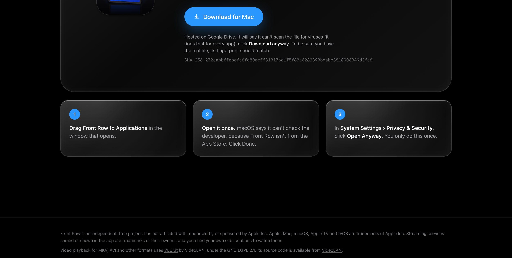
</p>

<p align="center">
  <a href="../../releases/latest"><b>⬇︎ Download Front Row for Mac</b></a>
  &nbsp;·&nbsp; Free &nbsp;·&nbsp; macOS 14 Sonoma or later &nbsp;·&nbsp; Apple silicon and Intel
</p>

---

**Front Row turns your Mac into a TV.** The streaming services you already pay for sit side by side with your own films and shows, under one calm, glassy home screen you can drive from the keyboard.

<p align="center">
  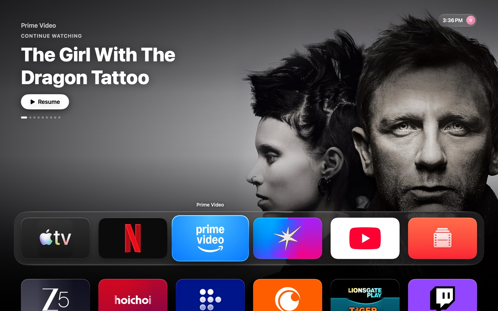
</p>

## What's inside

<table>
  <tr>
    <td width="50%" valign="top">
      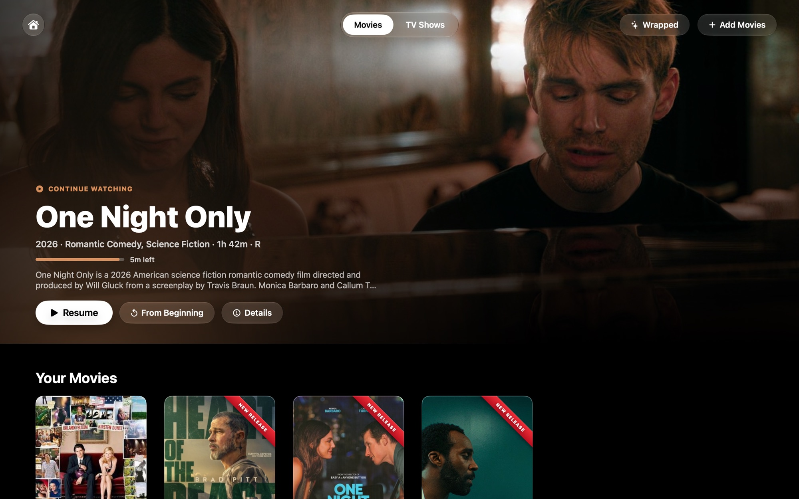
      <h3>Your Space</h3>
      Add a folder of films and shows and Front Row finds posters, key art, cast and episode guides. MKV, AVI and more play right inside. Posters get a little ribbon when a film is a new release, an Oscar winner, a blockbuster or a classic.
    </td>
    <td width="50%" valign="top">
      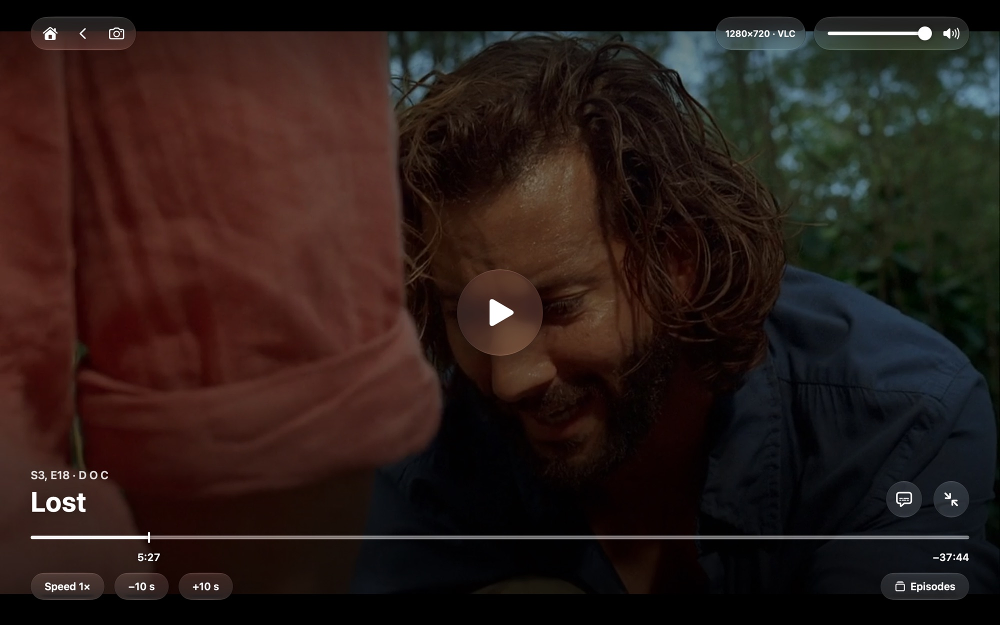
      <h3>A player made of glass</h3>
      Big, quiet controls that get out of the way. Subtitle and audio menus with clean track names, online subtitle search, Picture in Picture and full screen in a click.
    </td>
  </tr>
  <tr>
    <td width="50%" valign="top">
      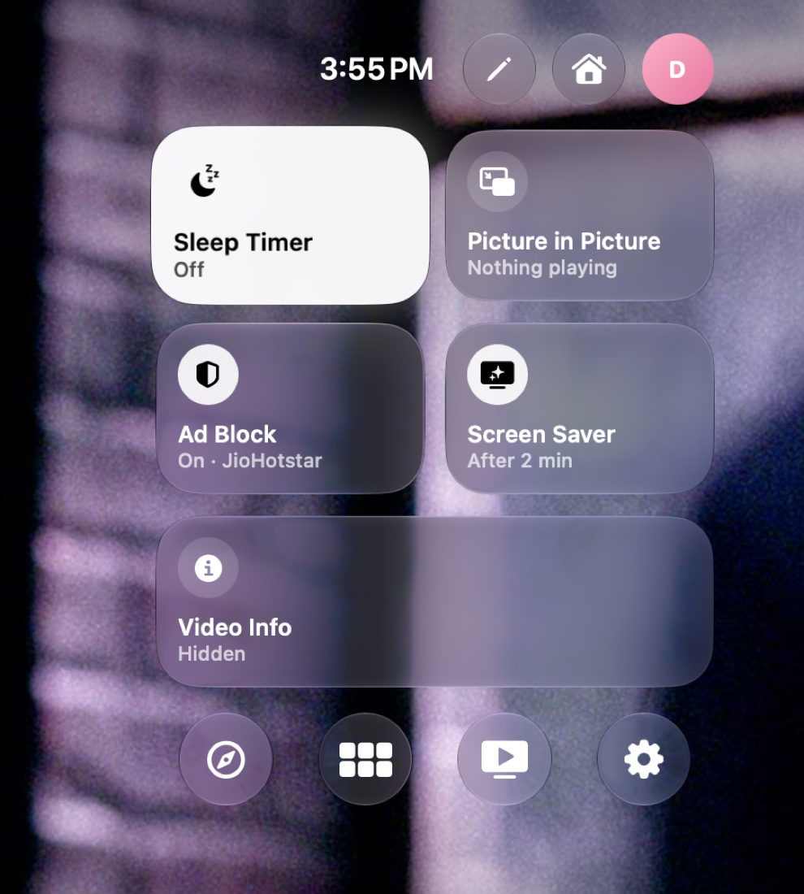
      <h3>Control Center, your way</h3>
      Sleep timer, volume boost (up to 300%, with a soft limiter), Picture in Picture and the screen saver. Add the controls you use and remove the ones you don't.
    </td>
    <td width="50%" valign="top">
      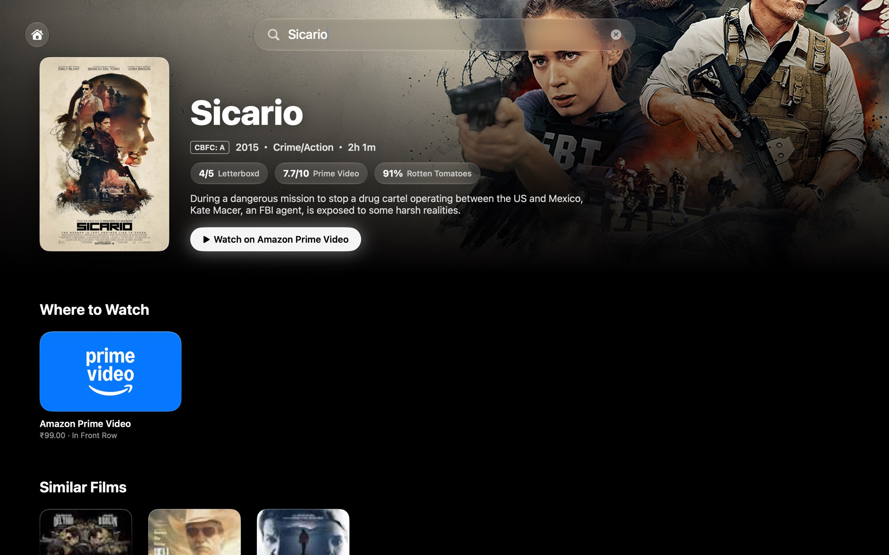
      <h3>Search any film</h3>
      Look up a film to see its details, ratings, similar films and where it's streaming.
    </td>
  </tr>
</table>

## Shows, done properly

<p align="center">
  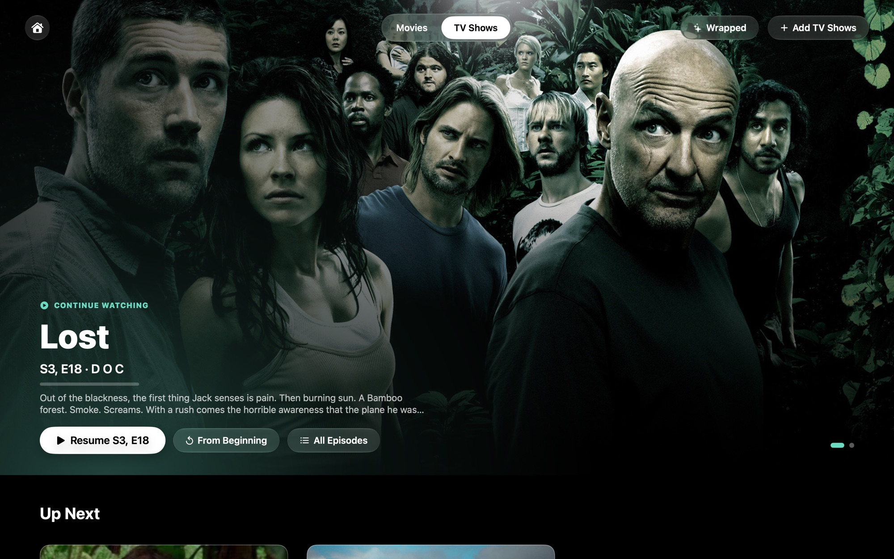
</p>
<p align="center">
  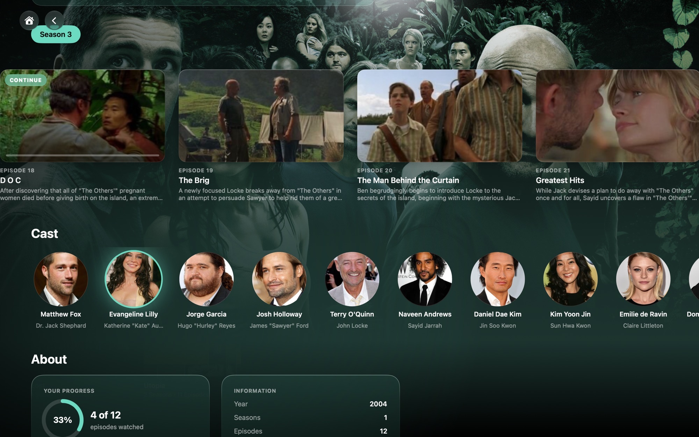
  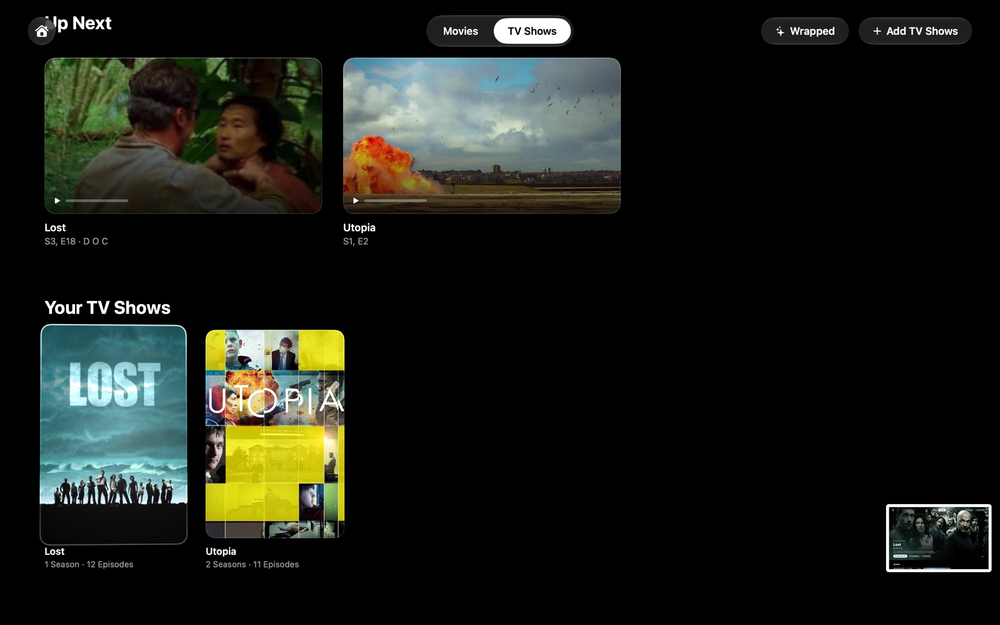
</p>
<p align="center">
  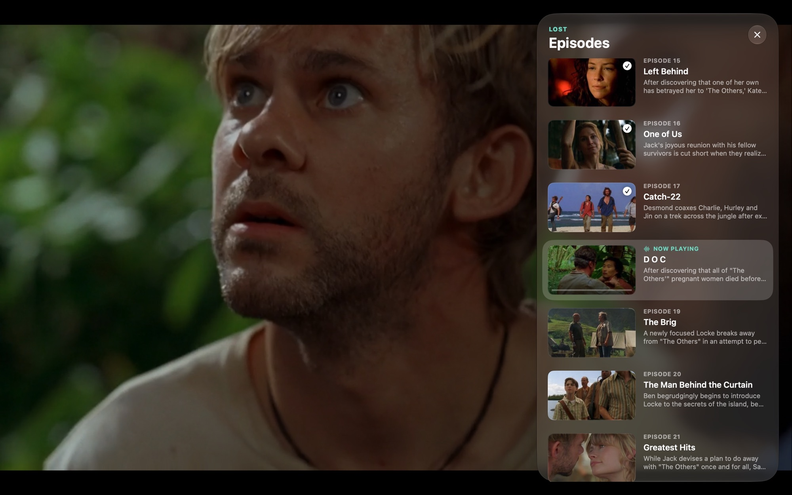
</p>

Every show gets its key art, episodes by season with synopses and stills, the cast, and how far through you are. Up Next always knows where you left off.

**Also:** a screen saver built from your own key art, tvOS-style scenery or Aerial videos · separate profiles for everyone at home · a Settings window for the things you set once.

<sub>Screenshots of Front Row 0.1 on macOS 26. The Ad Block control in the Control Center picture isn't included in the public download.</sub>

## Private by design

<p align="center">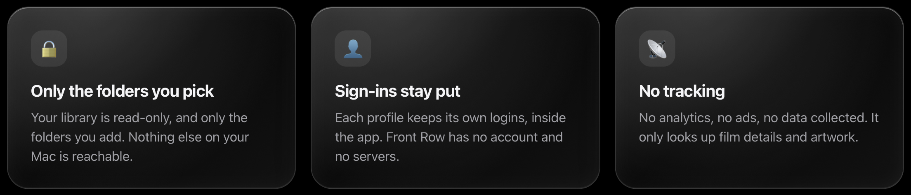</p>

Front Row runs in Apple's App Sandbox. It reads only the folders you add, keeps each profile's sign-ins inside the app, and has no account, no servers, no analytics and no ads. The only things it looks up online are film details and artwork.

## Install

1. Download **Front Row.dmg** from the [latest release](../../releases/latest) and open it.
2. Drag **Front Row** into **Applications**.
3. Open Front Row once. macOS says it can't check the developer, because Front Row isn't from the App Store. Click **Done**.
4. Open **System Settings › Privacy & Security**, scroll down and click **Open Anyway**. You only do this once.

**Check your download.** The SHA-256 fingerprint of `Front Row.dmg` (version 0.1) is:

```
272eabbffebcfc6fd80ecff313176d1f5f83e6282393bdabc3818906349d3fc6
```

You can check it in Terminal with `shasum -a 256 ~/Downloads/Front\ Row.dmg`.

## Requirements

| | |
|---|---|
| macOS | 14 Sonoma or later (the Liquid Glass look needs macOS 26) |
| Mac | Apple silicon or Intel |
| Streaming | Your own subscriptions to the services you want to watch |
| 4K Netflix | An Apple silicon Mac (or an Intel Mac with a T2 chip) and a 4K display |

## FAQ

**Is it really free?** Yes. No ads, no subscription, no account.

**Why does macOS warn me the first time?** Front Row isn't signed with a paid Apple Developer certificate yet, so macOS asks you to confirm once. The fingerprint above lets you check the file is genuine.

**Does it work with my streaming services?** Front Row opens each service's own website, so anything that plays in Safari plays here, with your own sign-in.

## Licences

Front Row plays MKV, AVI and other formats with [VLCKit](https://code.videolan.org/videolan/VLCKit) by VideoLAN, free software under the [GNU LGPL 2.1](https://www.gnu.org/licenses/old-licenses/lgpl-2.1.html). The app includes VLCKit 3.7.3, unmodified.

Front Row is an independent project and is not affiliated with, endorsed by or sponsored by Apple Inc. Apple, Mac, macOS, Apple TV and tvOS are trademarks of Apple Inc. Streaming services are trademarks of their owners.
